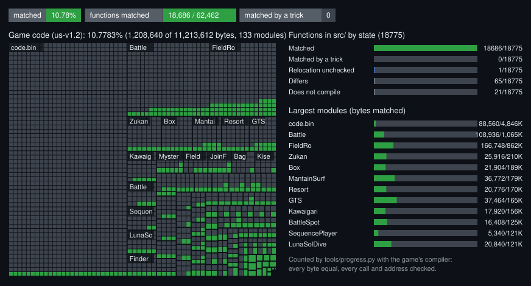

# Pokémon Ultra Sun / Ultra Moon: matching decompilation

C++ source that the game's own compiler turns into the game's bytes, function
by function. A work in progress.

This repository holds source, addresses and names only. **No game file and no
compiler is part of it**: you bring your own copy of the game, and the
compiler. It is a decompilation, not a port, and builds nothing playable.

## Status



Targets: **Ultra Sun and Ultra Moon**, USA, update v1.2. The two are one
program built twice: of Ultra Sun's 61,471 functions, 99.5% are the same code
in Ultra Moon (86.5% byte for byte in place, 13.0% only moved), and 335
differ (`tools/versions.py`, `config/um-v1.2/map.csv`). A source names
Ultra Sun's address and is checked against both: `MATCH_VERSION=um-v1.2`
makes the tools compare with Ultra Moon, through the map. The numbers below
are Ultra Sun's; today every function matched in one is matched in the other.
The functions that differ are written once, with `GAME_VERSION`
(`include/version.h`), the one switch the game itself was built with.

The picture is drawn by `tools/status.py` from the last `tools/progress.py`
run; `docs/history.csv` has the numbers over time.

A function counts when the compiler's output for its source is equal to the
game's in every byte, every call and address in it checked, and the source
uses no trick to get there ([Honest matches](CONTRIBUTING.md#honest-matches)).

## Quick start

```sh
python -I tools/match.py show 0x00360D68                              # the game's code
python -I tools/match.py check src/main/gfl2/Fade/FadeManager.cpp 0x00360D68    # RESULT: MATCH
python -I tools/progress.py                                           # everything in src/
```

Setup (the game's files, the compiler, Python) and the rules for sources are
in [CONTRIBUTING.md](CONTRIBUTING.md).

## Layout

| Path | What |
| --- | --- |
| `src/main/`, `src/<Module>/` | the sources, by program: the executable and each of the 132 modules. Every function is named by a `//!` line above it. Written sources go in folders by namespace (`src/main/gfl2/Fade/`) |
| `src/<program>/units/` | translation units of the game that a person filled, by their static initializer |
| `src/<program>/generated/` | not in the repository: written on your machine by the tools from your copy of the game (`python -I tools/refresh.py --derive`): the smallest functions from their instructions (`tiny_NNN.cpp`), empty virtual destructors from the headers (`dtors_NNN.cpp`), a matched function's twins with their own constants (`twins_NNN.cpp`), and the translation units known only by their static initializer (`units/`) |
| `include/` | the headers. One per class the game names, written by `tools/headers.py` as a skeleton (bases, virtual functions in vtable order) until someone fills it |
| `config/us-v1.2/` | `functions.csv` (every function: start, end, mode, name, class, virtual slot, library), `classes.csv` and `vtables.csv` (the classes the game names in its RTTI: bases, virtual functions by slot), `ctors.csv` (constructors and destructors), `signatures.csv` (the game's exported names, demangled), `symbols.txt` (names we gave), `flagsets.txt`, `honest_allow.txt` |
| `tools/` | `match.py` (the check), `progress.py`, `status.py`, `honest.py`, `functable.py`, `tiny.py`, `twins.py`, `units.py`, `rtti.py`, `ctors.py`, `classify.py`, `fields.py`, `headers.py`, `bounds.py`, `enums.py` (the enums and their sizes, from their callers), `callers.py` (return types, from what callers do with the result), `versions.py` (Ultra Moon against Ultra Sun), `tailstarts.py` (function starts hidden by a tail call the linker made a NOP), `unreached.py` (starts hidden after code nothing reaches), `slotargs.py` (the parameters of virtual functions, from their code), `copies.py` (a class's function at its copies in other programs), `refresh.py` (runs them in order), `cro.py` |
| `docs/` | `status.svg`, `history.csv` |
| `orig/`, `toolchain/`, `build/` | yours: the game, the compilers, what the tools write (ignored) |

## Credits

- [decomp.me](https://decomp.me) and [decompme/compilers](https://github.com/decompme/compilers):
  the armcc build that is the judge here. armcc (ARM Compiler) is Arm's.
- The tools ([matching-decomp-tools](https://github.com/ShiromiyaG/matching-decomp-tools), MIT) stand on
  [Capstone](https://www.capstone-engine.org/), [objdiff](https://github.com/encounter/objdiff),
  [Ghidra](https://github.com/NationalSecurityAgency/ghidra) and, as references only,
  [m2c](https://github.com/matt-kempster/m2c) and IDA; their README credits each.
- [3dbrew](https://www.3dbrew.org/), for the 3DS formats (CRO modules, ExeFS).
- The decompilation projects of the community, [zeldaret](https://github.com/zeldaret)'s among
  them, whose way of working (a repository of sources people wrote, each person's own copy of
  the game) this one follows.

## Legal

No assets, no assembly, no bytes or tables of the game, no ROMs or keys. No
leaked material of any kind was used or is accepted. Not affiliated with
Nintendo, Game Freak or The Pokémon Company.

The repository holds only sources people wrote. What the tools write from the game's code
(`src/<program>/generated/`) is made on each person's machine from their own copy, like the
rest of `orig/` and `build/`, and is never committed. A decompiler's output is never a
source here.

## License

What is written here is dedicated to the public domain under CC0 1.0 (`LICENSE`). It gives no
right to the game, which belongs to its owners: bring your own copy. The tools are MIT, in
their own repository.
